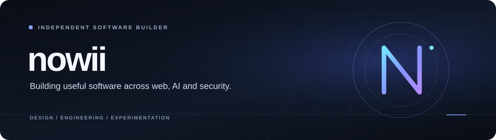

  
    
  
  

 

## About

I'm **nowii**, an independent developer building practical software and experimenting with ideas across **web development, AI, security, and interactive experiences**.

I like turning concepts into working products: from browser-based tools and local-first assistants to visual experiments and developer utilities. I focus on clear interfaces, useful functionality, and projects people can actually try.

> **Build with purpose. Make it work. Make it better.**

---

## Featured work

A selection of projects from the nowii-core workspace.

<table>
  <tr>
    <td width="50%" valign="top">
      <h3>Avora Assistant</h3>
      
A local-first AI assistant powered by Ollama, with chat, tools, voice, file support, and locally stored conversations.

      

        <a href="https://nowii-core.github.io/avora-assistant/"><strong>Live demo ↗</strong></a> ·
        <a href="https://github.com/nowii-core/avora-assistant">Source ↗</a>
      

      Python · Ollama · SQLite
    </td>
    <td width="50%" valign="top">
      <h3>PhishLens</h3>
      
A browser-based security analysis tool for inspecting suspicious URLs, messages, and email authentication signals.

      

        <a href="https://nowii-core.github.io/phishlens/"><strong>Live demo ↗</strong></a> ·
        <a href="https://github.com/nowii-core/phishlens">Source ↗</a>
      

      JavaScript · Privacy-first · PWA
    </td>
  </tr>
  <tr>
    <td width="50%" valign="top">
      <h3>SafeStep AR</h3>
      
An experimental mobile terrain-scanning concept exploring camera-based surface analysis and step guidance.

      

        <a href="https://nowii-core.github.io/safe-step-vision/"><strong>Live demo ↗</strong></a> ·
        <a href="https://github.com/nowii-core/safe-step-vision">Source ↗</a>
      

      HTML · CSS · JavaScript · Device sensors
    </td>
    <td width="50%" valign="top">
      <h3>ctx-pack</h3>
      
A zero-dependency CLI that packages codebases into clean, LLM-ready context while respecting ignore rules and redacting common secrets.

      

        <a href="https://github.com/nowii-core/context-packer"><strong>View project ↗</strong></a>
      

      Node.js · CLI · Zero dependencies
    </td>
  </tr>
  <tr>
    <td width="50%" valign="top">
      <h3>HyperDash</h3>
      
A browser platformer built around a custom 4D engine, procedural levels, and dimension-switching mechanics.

      

        <a href="https://nowii-core.github.io/Hyperdash/hyperdimension-2/"><strong>Play demo ↗</strong></a> ·
        <a href="https://github.com/nowii-core/Hyperdash">Source ↗</a>
      

      JavaScript · Canvas · WebGL2
    </td>
    <td width="50%" valign="top">
      <h3>nowii Portfolio</h3>
      
A personal showcase for selected work, experiments, and creative development.

      

        <a href="https://nowii-core.github.io/portfoglio/nowii-portfolio/"><strong>Visit portfolio ↗</strong></a> ·
        <a href="https://github.com/nowii-core/portfoglio">Source ↗</a>
      

      HTML · CSS · JavaScript
    </td>
  </tr>
</table>

---

## What I work with

  
  
  
  
  
  
  
  
  

I’m especially interested in:
- **Product engineering** — useful tools, thoughtful UX, and responsive interfaces.
- **Applied AI** — local models, assistants, and practical automation.
- **Security & privacy** — browser-side analysis and privacy-conscious software.
- **Creative technology** — interactive graphics, games, and experiments.

---

## Explore

- **All repositories:** [github.com/nowii-core?tab=repositories](https://github.com/nowii-core?tab=repositories)
- **Portfolio:** [nowii-core.github.io/portfoglio/nowii-portfolio/](https://nowii-core.github.io/portfoglio/nowii-portfolio/)
- **Instagram:** [@nowii.core](https://instagram.com/nowii.core)
- **Telegram:** [nowii-core bot](https://t.me/nowii_core_bot)

---

  Independent projects · Built and maintained by <a href="https://github.com/nowii-core"><strong>nowii-core</strong></a>
   
  Thanks for stopping by.

